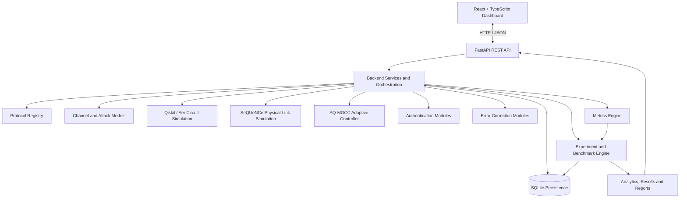

# AQShield

**Adaptive Quantum Secure Direct Communication Research Platform**

AQShield is a full-stack research and simulation platform for exploring adaptive quantum communication under noisy channels and modeled adversarial conditions. It brings together quantum circuit simulation, quantum-network link simulation, channel-aware decision-making, attack modelling, performance benchmarking, and interactive research analytics in one application.

The project investigates how an adaptive controller can respond to changes in communication conditions and how those decisions affect security-related and performance-related metrics.

Rather than treating the quantum protocol, simulation engine, adaptive controller, and user interface as separate demonstrations, AQShield connects them through a modular backend and a unified research dashboard.

> **Project status:** Research prototype. Quantum circuit demonstrations, physical-link simulations, analytical protocol models, and adaptive control are integrated at different levels of fidelity. The platform is intended for experimentation and evaluation, not deployment in operational defence communication systems.

---

## Overview

The central idea behind AQShield is straightforward: communication strategies should account for changing channel conditions rather than relying entirely on fixed parameters.

A quantum communication system may encounter channel noise, photon loss, measurement errors, or adversarial interference. These conditions can affect the quality and reliability of transmission. AQShield models these scenarios, evaluates the resulting channel observations, and uses an adaptive controller to select communication parameters.

The framework combines:

- **Quantum simulation:** Qiskit and Qiskit Aer circuit execution for selected protocol demonstrations.
- **Network simulation:** SeQUeNCe-based discrete-event simulation of a two-node photonic link.
- **Adaptive decision-making:** AQ-MOCC, a Bayesian risk-aware, utility-based controller.
- **Security experimentation:** Configurable attack scenarios with differentiated disturbance models.
- **Performance evaluation:** Thirteen security and performance metrics.
- **Experiment management:** Repeated runs, parameter sweeps, stored results, and protocol comparisons.
- **Research interface:** A React and TypeScript application for simulations, benchmarking, network visualization, analytics, and reports.

The goal is to make the reasoning, execution, and evaluation of a communication experiment inspectable from start to finish.

## System Architecture

AQShield follows a modular, API-driven architecture. The frontend handles configuration and visualization, while the backend coordinates simulation, adaptation, evaluation, and persistence.



The diagram represents the main components and their relationships. The exact execution path depends on the selected protocol and simulation backend; not every run invokes every module.

### How a simulation works

1. A user selects a protocol, message, channel configuration, attack scenario, and simulation backend.
2. The frontend submits the configuration to the FastAPI backend.
3. The backend validates the request and invokes the relevant protocol and simulation services.
4. The channel and attack models represent the configured operating conditions.
5. AQ-MOCC evaluates the available channel observations and selects an adaptive configuration for the AQShield flow.
6. Authentication, recovery, and transmission logic contribute to the resulting simulation outcome, according to the selected execution path.
7. The metrics engine calculates the run's security and performance indicators.
8. The system stores experiment and run information for subsequent comparison, analysis, and reporting.
9. The frontend presents the resulting metrics, execution trace, adaptation decision, and experiment summary.

The circuit-level BB84 preview follows a more specific path: it obtains QBER from Qiskit Aer measurement outcomes and passes that measurement-derived value into the adaptive decision logic.

---

## Core Components

### 1. Protocol Engine

The protocol registry provides a common interface for selecting and executing protocol implementations or comparison models.

The registry contains ten entries: AQShield and nine baseline protocol families.

| Protocol | Role |
|---|---|
| AQShield | Proposed adaptive communication framework |
| BB84 | Quantum Key Distribution baseline |
| E91 | Entanglement-based QKD baseline |
| B92 | Two-state QKD baseline |
| SARG04 | QKD comparison protocol |
| Ping-Pong | Two-way QSDC comparison protocol |
| Deng–Long | QSDC comparison protocol |
| LM05 | Two-way quantum communication comparison |
| Superdense Coding | Entanglement-assisted communication comparison |
| Hybrid QKD/QSDC | Hybrid analytical comparison model |

Protocol implementation depth varies. The registry includes circuit-backed protocol demonstrations as well as analytical comparison models. The presence of a protocol in the registry does not imply that every protocol has been implemented and validated at the same physical or circuit level.

### 2. Quantum Simulation

AQShield uses Qiskit and Qiskit Aer to construct and execute selected quantum circuit demonstrations.

The BB84 preview models the main prepare-and-measure process:

- Random bit and basis selection by Alice.
- Quantum-state preparation.
- Optional intercept-resend interference by Eve.
- Receiver basis selection and measurement.
- Basis sifting.
- Error counting and QBER calculation.

The preview returns per-qubit traces, allowing the frontend to display Alice's preparation, Eve's interaction, Bob's measurement, basis matches, and observed errors.

The repository also contains additional quantum circuit modules for protocols such as B92, E91, SARG04, LM05, and Superdense Coding. Their modelling scope and integration depth vary.

### 3. Quantum-Network Simulation

SeQUeNCe provides a separate physical-link simulation path.

The implemented link model uses a discrete-event timeline to simulate two nodes communicating over a polarization-encoded photonic channel. It records quantities including:

- Photons transmitted and received.
- Observed photon loss.
- Measured QBER.
- Propagation delay.
- Executed simulation events.

The SeQUeNCe component is a physical-link validation layer. It is not a complete SeQUeNCe implementation of the entire AQShield QSDC protocol.

When a run combines physical-link output with analytical channel observations, the results should be interpreted as hybrid simulation evidence.

### 4. AQ-MOCC Adaptive Controller

The **Adaptive Quantum Multi-Objective Channel Controller (AQ-MOCC)** is the decision-making component of the proposed framework.

Its purpose is to evaluate observed communication conditions and choose an operating profile that balances security-related objectives with communication efficiency.

The controller uses:

- Channel observations and disturbance indicators.
- Bayesian attack-risk estimation using a Beta-posterior model.
- A predefined set of feasible operating profiles.
- Deterministic utility-based profile selection.
- Adaptation parameters such as decoy rate, basis bias, error-correction rate, and retry budget.

The current controller is deterministic and risk-aware, rather than a trained machine-learning or reinforcement-learning policy. This makes its decisions traceable and reproducible while leaving room for future optimization research.

### 5. Attack Modelling

The attack catalogue provides configurable adversarial scenarios for controlled experimentation.

Supported scenario families include:

- Intercept-resend.
- Noise injection.
- Man-in-the-middle.
- Replay.
- Fake-node or impersonation scenarios.
- Photon-splitting approximation.
- Packet disruption.
- Denial of communication.

The models assign different behavioural effects to channel conditions and resulting metrics. These can include changes in QBER, photon loss, latency, and detection-related indicators.

The intercept-resend mechanism has a circuit-level implementation in the BB84 preview. The remaining attack scenarios primarily operate through behavioural models, rather than complete quantum adversary implementations.

This distinction is important when interpreting attack results.

### 6. Authentication and Error Correction

The repository contains experimental modules for communication verification and recovery.

Authentication-related components include GHZ-state generation and verification, together with a classical keyed-MAC demonstration.

Error-correction components include:

- CSS/Steane-style quantum error-correction circuit demonstrations.
- LDPC-based iterative decoding routines.
- Cascade-style key-reconciliation routines.

These modules explore complementary approaches to verification, correction, and reconciliation. They should not be interpreted as a complete, security-certified authentication and error-correction pipeline for a deployable QSDC system. Their integration and validation depth differs across the execution paths.

### 7. Metrics Engine

The metrics engine produces thirteen requested evaluation metrics:

| Metric | What it describes |
|---|---|
| QBER | Fraction of compared bits that disagree |
| Secure communication rate | Estimated rate of useful secure communication |
| Throughput | Communication efficiency under the selected model |
| Fidelity | Similarity measure for the represented quantum or communication state |
| Leakage probability | Estimated information-leakage risk |
| Eavesdropping detection rate | Detection-related performance |
| Authentication accuracy | Authentication-related performance estimate |
| Channel utilisation | Effective use of the communication channel |
| Latency | Communication or simulated propagation delay |
| Noise robustness | Resilience under the configured disturbance model |
| Computational overhead | Estimated computation-related cost |
| Circuit depth | Circuit-depth estimate where applicable |
| Resource consumption | Resource estimate under the selected model |

Not every metric is directly measured by a quantum circuit or network simulator. Some metrics are model-derived estimates, and their interpretation depends on the simulation path and underlying assumptions.

---

## Research and Benchmarking

AQShield separates interactive simulations from large-scale analytical benchmarking.

### Interactive simulation

The Simulation Center supports an individual run with a selected protocol, message, channel configuration, attack scenario, and backend.

Results can include the recovered message, QBER, latency, throughput, fidelity, detection-related values, adaptation decisions, and network-link observations where applicable.

### Benchmark experiments

The experiment system supports configurable protocol sets and repeated evaluation across parameter ranges.

The benchmark engine can vary:

- Channel noise.
- Attack intensity.
- Photon loss.
- Protocol selection.
- Repetition count.

It aggregates results and generates CSV output containing the individual runs and calculated summary statistics, including means, standard deviations, and approximate 95% confidence intervals for selected metrics.

The generated results can then be used for protocol comparison, plotting, and further analysis.

### Reproducibility

The project uses configurable seeds in its quantum and network simulation paths and supports saved run and experiment records.

Reproducible research still requires recording the actual configuration, seed, software version, simulation backend, model type, and source revision. A repeatable run is not automatically an independent validation of a protocol's security.

---

## Application Interface

The frontend is a separate React application built with TypeScript and Vite. It communicates with the backend using the REST API rather than directly accessing simulation modules or the database.

The main views are:

- **Dashboard:** Overview of simulation activity, communication status, metrics, and recent results.
- **Simulation Center:** Configure and execute individual simulations, inspect transmission traces, and review adaptive responses.
- **Benchmark Laboratory:** Run and compare protocol experiments across configurable conditions.
- **Attack Center:** Explore adversarial scenarios and their simulated effects.
- **Research Analytics:** Inspect metric trends, protocol comparisons, attack-related results, and rankings.
- **Mission Reports:** Review experiment summaries and research findings.
- **Knowledge Base:** Consult protocol, metric, and security-related explanations.

The interface is designed to make otherwise abstract simulation outputs easier to inspect. Visual indicators and animations represent the state and results returned by the system; they are not independent evidence of quantum behaviour.

---

## Technology Stack

| Technology | Purpose |
|---|---|
| Python | Simulation logic, protocol execution, adaptation, and analysis |
| FastAPI | Backend REST API and request validation |
| Pydantic | Structured request and response schemas |
| Uvicorn | ASGI server for local development |
| Qiskit | Quantum-circuit construction |
| Qiskit Aer | Local circuit simulation and measurement sampling |
| SeQUeNCe | Discrete-event quantum-network and physical-link simulation |
| NumPy | Numerical operations used by the research modules |
| React | Frontend component architecture |
| TypeScript | Typed frontend code and API contracts |
| React Router | Client-side navigation |
| Vite | Frontend development server and production build |
| Recharts | Interactive data visualization |
| SQLite | Local persistence for run and experiment data |
| pytest | Backend, simulation, and integration testing |

The local development workflow does not require external AI-service API keys or cloud quantum hardware access.

---

## Getting Started

### Prerequisites

Install the following before running the project:

- Python 3.11 or a compatible Python version for the pinned dependencies.
- Node.js and npm compatible with the Vite version specified in `frontend/package.json`.
- Git, if cloning the repository.

SeQUeNCe has additional dependencies, so installation compatibility can depend on your operating system and Python environment.

### 1. Set up the backend

Open a terminal in the repository root.

Create and activate a virtual environment:

```bash
python3 -m venv .venv
source .venv/bin/activate
```

On Windows, activate it with:

```powershell
.venv\Scripts\Activate.ps1
```

Install the Python dependencies:

```bash
python -m pip install --upgrade pip
pip install -r requirements.txt
```

Create a local environment file:

```bash
cp .env.example .env
```

The supplied example configuration uses SQLite for persistence and does not require external credentials.

Start the backend:

```bash
uvicorn backend.app.main:app --reload --host 127.0.0.1 --port 8000
```

The API should now be available at:

- API root: `http://127.0.0.1:8000/`
- Interactive API documentation: `http://127.0.0.1:8000/docs`
- Health check: `http://127.0.0.1:8000/api/v1/health`

Keep this terminal running.

### 2. Set up the frontend

Open a second terminal and navigate to the frontend directory:

```bash
cd frontend
npm install
npm run dev
```

Open the development URL printed by Vite. By default, AQShield uses:

`http://127.0.0.1:5173/`

The Vite configuration proxies `/api` requests to the backend at `http://127.0.0.1:8000`, allowing the frontend to call the local API during development.

### 3. Verify the backend

With the backend running, test the health endpoint:

```bash
curl http://127.0.0.1:8000/api/v1/health
```

You should receive a JSON response indicating that the service is running.

You can also inspect the available endpoints at `/docs`, where FastAPI exposes interactive request and response documentation.

### 4. Run a circuit-level BB84 preview

The BB84 preview endpoint can be tested without going through the frontend:

```bash
curl -X POST \
  http://127.0.0.1:8000/api/v1/quantum/bb84-preview \
  -H "Content-Type: application/json" \
  -d '{
    "num_qubits": 24,
    "eavesdrop": true,
    "seed": 7
  }'
```

The response contains the simulated qubit trace, basis-matching information, sifted length, measured QBER, and the adaptation decision derived from that QBER.

Because the run samples measurement outcomes over a finite number of qubits, the observed QBER can vary with the seed and sample size. It should not be expected to equal the theoretical expectation in every individual run.

---

## Running Tests

Run the backend test suite from the repository root with the virtual environment activated:

```bash
pytest -q
```

Build the frontend:

```bash
cd frontend
npm run build
```

Run the frontend linter:

```bash
npm run lint
```

The SeQUeNCe-dependent test paths require the corresponding dependency to be installed. For a meaningful validation, use a clean environment with the pinned requirements rather than relying solely on results from an existing development machine.

---

## Running Benchmark Sweeps

The benchmark command-line interface runs parameter sweeps and produces raw and aggregated CSV files.

For a quick sweep:

```bash
python -m benchmarking.cli --quick
```

For a larger sweep:

```bash
python -m benchmarking.cli --iterations 50
```

To limit the run to selected protocols:

```bash
python -m benchmarking.cli \
  --quick \
  --protocols aqshield bb84 ping-pong
```

The outputs are written to `benchmark_results/` by default.

The plotting utilities in `benchmarking/plot_results.py` can generate comparison figures from the aggregated statistics. Inspect the output files and plotting command interfaces in the source before automating a larger research campaign.

---

## API Reference

FastAPI serves the interactive OpenAPI documentation at:

`http://127.0.0.1:8000/docs`

The main API groups are:

| Endpoint | Purpose |
|---|---|
| `GET /api/v1/health` | Backend health check |
| `GET /api/v1/protocols` | List registered protocols |
| `GET /api/v1/attacks` | List supported attack scenarios |
| `GET /api/v1/metrics/snapshot` | Retrieve a metrics summary |
| `POST /api/v1/runs` | Execute a simulation run |
| `GET /api/v1/runs` | Retrieve recent persisted runs |
| `POST /api/v1/quantum/bb84-preview` | Run the circuit-level BB84 preview |
| `POST /api/v1/experiments` | Create a benchmark experiment |
| `GET /api/v1/experiments` | Retrieve experiment summaries |
| `GET /api/v1/experiments/{experiment_id}` | Retrieve experiment details |
| `GET /api/v1/experiments/{experiment_id}/report` | Retrieve a generated experiment report |

Request and response schemas are defined in the backend and are available through the interactive documentation.

---

## Repository Structure

```text
AQShield/
├── backend/
│   └── app/
│       ├── api/              # API routers and endpoint definitions
│       ├── core/             # Application configuration
│       ├── models/           # Persistence models
│       ├── schemas/          # Request and response contracts
│       └── services/         # Simulation, experiment, and API services
├── quantum/                  # Qiskit circuit modules
├── simulation/               # Channel, transmission, and SeQUeNCe logic
├── protocols/                # Protocol interfaces, implementations, registry
├── adaptive/                 # AQ-MOCC and adaptive decision logic
├── authentication/           # Authentication demonstrations
├── error_correction/         # CSS/Steane, LDPC, and Cascade modules
├── attacks/                  # Attack catalogue and disturbance models
├── metrics/                  # Metric calculation and result models
├── experiments/               # Experiment orchestration
├── benchmarking/              # Parameter sweeps, statistics, and plots
├── database/                  # Persistence and repository layer
├── frontend/                  # React, TypeScript, Vite, and Recharts
├── tests/                     # Automated tests
├── docs/                      # Architecture and research documentation
├── scripts/                   # Development scripts
├── benchmark_results/         # Generated benchmark outputs and plots
├── requirements.txt           # Pinned Python dependencies
├── .env.example               # Example local configuration
└── README.md
```

Generated benchmark results and local database files are runtime artifacts. Keep large generated outputs, local credentials, and machine-specific files out of version control unless they are deliberately included as research evidence.

---

## Research Scope and Limitations

AQShield is designed to support research experimentation. Its outputs must be interpreted according to how each simulation path is implemented.

**Circuit-level evidence:** The BB84 preview uses Qiskit Aer to simulate preparation, measurement, basis sifting, and intercept-resend disturbance. Selected additional protocol modules also use Qiskit circuits, but their coverage and integration depth differ.

**Network-level evidence:** SeQUeNCe models a two-node photonic link and provides event-based measurements of transmission, loss, latency, and QBER. It does not currently represent every AQShield protocol component as a complete physical network simulation.

**Analytical evidence:** The fast benchmark engine uses protocol-specific models for large parameter sweeps. These are useful for controlled comparisons and sensitivity analysis, but they are not equivalent to running every protocol through an equivalent gate-level or network-level simulation.

**Adaptive control:** AQ-MOCC uses Bayesian risk estimation and deterministic utility-based selection among predefined profiles. The current implementation is not a trained machine-learning or reinforcement-learning agent, and the novelty of the controller has not been established through peer review.

**Authentication and error correction:** The repository contains authentication and correction modules at different levels of implementation. Their presence does not imply a complete, formally proven, end-to-end QSDC security protocol.

**Security claims:** AQShield has not established formal security guarantees for the full framework, nor has it been validated for real defence deployments or real quantum communication hardware.

These boundaries are part of the research methodology, not reasons to hide the implementation. Distinguishing measured simulator output from analytical estimates makes the results easier to reproduce, evaluate, and improve.

---

## Project Documentation

Additional technical details are maintained in the `docs/` directory:

- [`docs/architecture.md`](docs/architecture.md) — system architecture, component boundaries, and data flow.
- [`docs/research-methodology.md`](docs/research-methodology.md) — simulation fidelity, AQ-MOCC, metrics, and research methodology.
- [`docs/project-structure.md`](docs/project-structure.md) — codebase organization and module responsibilities.
- [`docs/roadmap.md`](docs/roadmap.md) — completed milestones and future research work.

---

## Future Work

The next stage of AQShield is focused on improving the scientific evidence behind the platform rather than simply expanding the interface.

Priority areas include:

- Integrating protocol-specific quantum and network simulation paths more consistently.
- Implementing and validating deeper protocol-level authentication and error-correction flows.
- Comparing AQ-MOCC against independently defined fixed and adaptive controllers.
- Running repeated experiments with documented seeds, parameter configurations, uncertainty estimates, and ablation studies.
- Validating analytical predictions against circuit-level and physical-link simulation results.
- Expanding baseline coverage without treating analytical profiles as equivalent to full protocol implementations.

These improvements would help establish which adaptive decisions provide measurable benefits, under what channel conditions they do so, and what trade-offs they introduce.

---

## Acknowledgements

AQShield was developed as a quantum communication research and engineering project, combining backend development, quantum simulation, adaptive modelling, experiment design, and frontend visualization.

The project is intended to serve as a foundation for further work in adaptive quantum communication, reproducible simulation, and security-performance evaluation.
